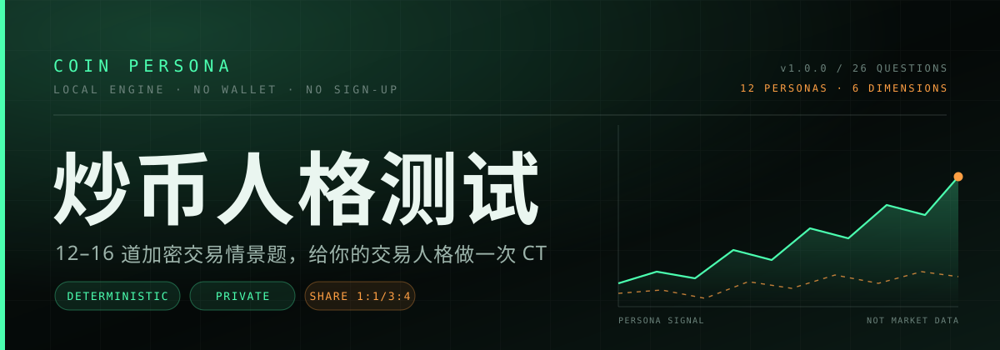
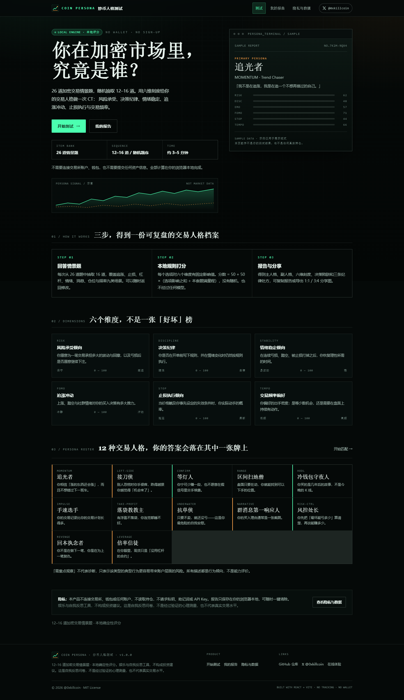
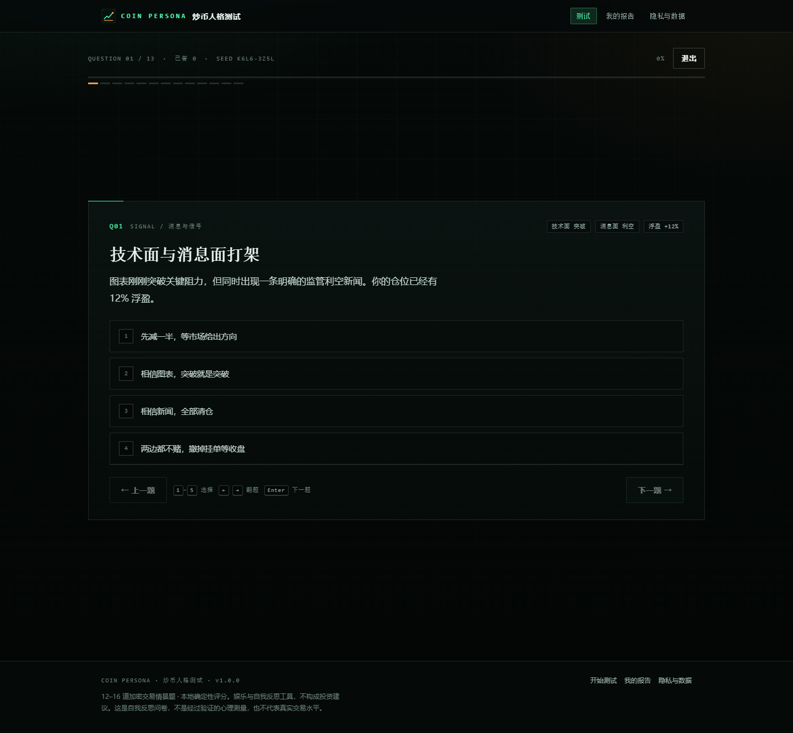
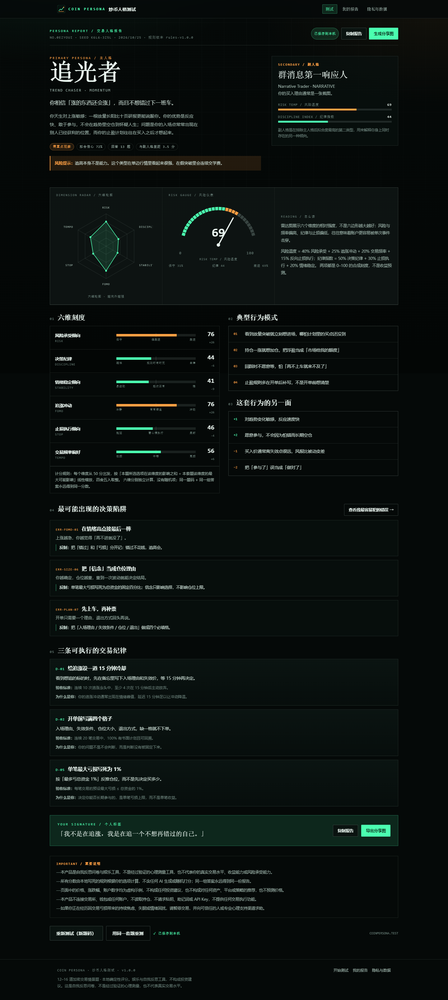
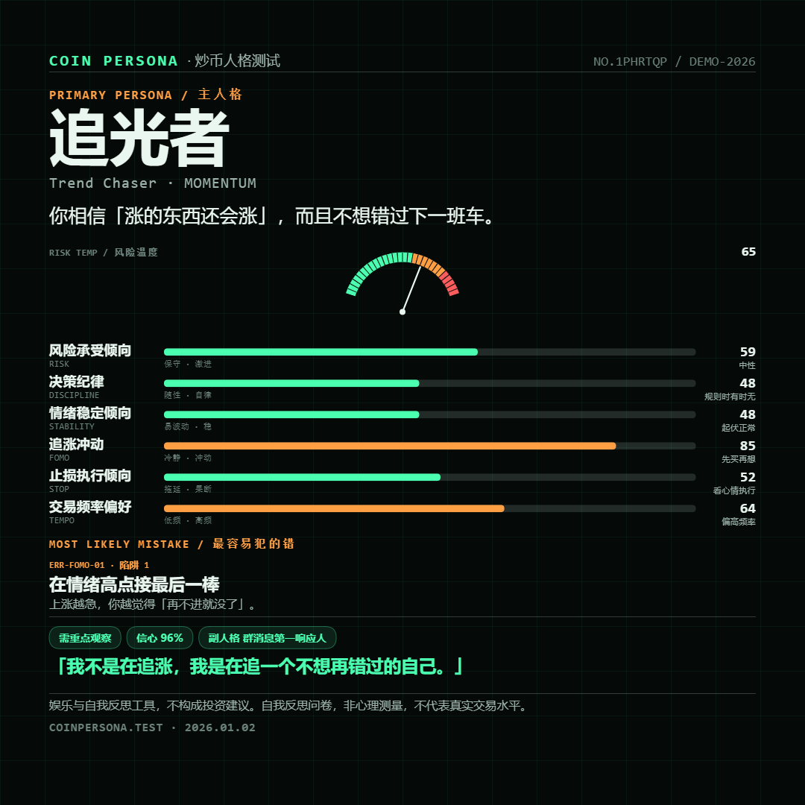
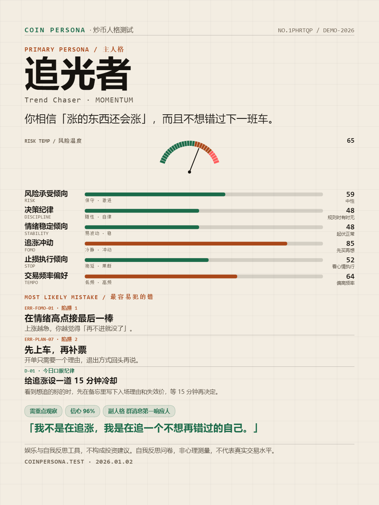
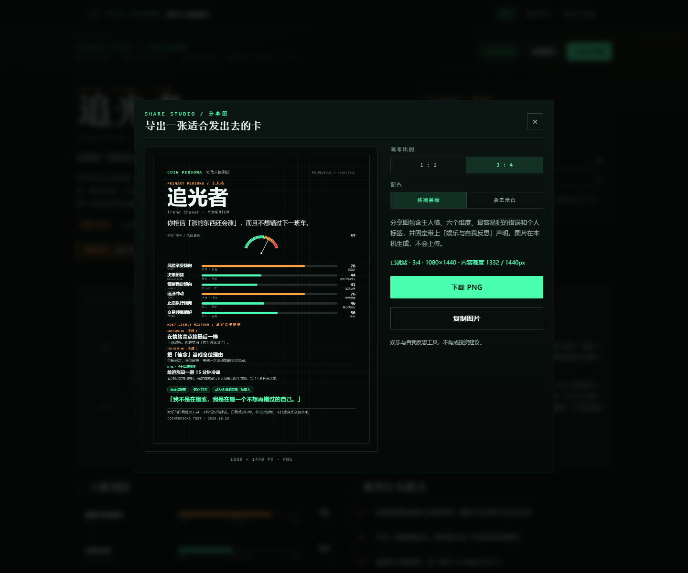
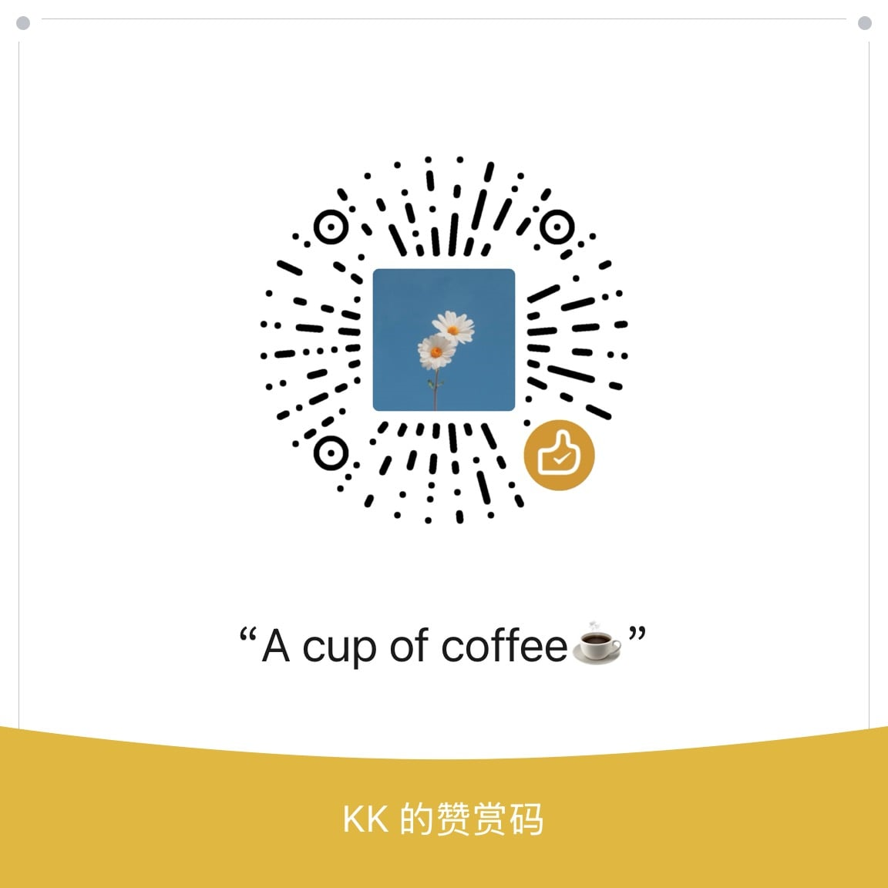

<div align="center">



<br />

**12–16 道加密交易情景题，给你的交易人格做一次 CT。**

不连接钱包 · 不接交易所 · 不上传数据 · 不提供投资建议

<br />

[](https://321.market/coin-persona/)
[](https://x.com/0xkillcoin)

<br />

[](https://react.dev/)
[](https://vitejs.dev/)
[](https://www.typescriptlang.org/)
[](#-测试与验收)
[](#-隐私承诺)
[](#-隐私承诺)
[](LICENSE)

</div>

---

<div align="center">

### 👉 [**点这里，3 分钟测出你的交易人格**](https://321.market/coin-persona/) 👈

*手机打开效果最好 · 无需登录 · 无需钱包*

</div>

---

## 📖 目录

- [这是什么](#-这是什么)
- [长什么样](#-长什么样)
- [你会得到什么](#-你会得到什么)
- [12 种交易人格](#-12-种交易人格)
- [题库设计](#-题库设计)
- [评分系统](#-评分系统确定性本地引擎)
- [交互细节](#-交互细节)
- [分享图](#-分享图11--34真实可导出)
- [技术架构](#-技术架构三部分离)
- [快速开始](#-快速开始)
- [测试与验收](#-测试与验收)
- [部署](#-部署)
- [隐私承诺](#-隐私承诺)
- [已知限制](#-已知限制)
- [支持作者](#-支持作者)

---

## 🎯 这是什么

一个**纯前端、无后端、无账号**的中文 Web 应用。

你回答一组模拟交易情景题（比如「跌破止损线，群里说是黄金坑，你会？」「凌晨三点插针，你没有条件单」），系统根据你选的选项，用一套**写死的规则**算出：

| 输出 | 说明 |
| :--- | :--- |
| 🎭 **主人格 + 副人格** | 12 种交易人格里最贴合你的两个 |
| 📊 **六维刻度** | 风险承受 / 决策纪律 / 情绪稳定 / 追涨冲动 / 止损执行 / 交易频率 |
| 🧠 **典型行为模式** | 4 条具体行为，附带这套行为的优点与盲区 |
| 🕳 **3 个决策陷阱** | 你最可能踩的坑，每个都有触发场景、代价和反制动作 |
| ✅ **3 条纪律处方** | 可执行的交易纪律，带量化验收标准 |
| 💬 **个人标签** | 一句适合发出去的话 |
| 🖼 **分享图** | 1:1 与 3:4，两套配色，真实 PNG |

> [!IMPORTANT]
> 这是**自我反思问卷**，不是经过验证的心理测量工具，也不代表你的真实交易水平、收益能力或风险承受能力。
> 页面里的价格、涨跌幅、账户数字均为虚构示例，**不构成任何投资建议**，也不预测价格。

<div align="center">

| 不是 | 是 |
| :---: | :---: |
| ❌ 投资建议 | ✅ 行为自省 |
| ❌ 心理测评 | ✅ 娱乐内容 |
| ❌ 收益预测 | ✅ 纪律清单 |
| ❌ 交易所工具 | ✅ 一张可以发出去的卡 |

</div>

---

## 🖼 长什么样

<div align="center">

**首页** — 交易终端 × 杂志编辑版式，没有满屏闪烁的行情



<br /><br />

**答题** — 一次一题，情景数据、进度条、可返回修改



</div>

---

## 🎁 你会得到什么

<div align="center">

</div>

<br />

报告不是一张图，而是一份**可以拿去复盘**的档案：

```text
┌─ 01 主人格 / 副人格 ─────────────────────────────┐
│  追光者 MOMENTUM · Trend Chaser                  │
│  「你相信涨的东西还会涨，而且不想错过下一班车。」 │
│  拟合信心 78% · 与副人格差距 12.4 分             │
├─ 02 六维雷达 + 风险仪表 ─────────────────────────┤
│  RISK 59 · DISCIPLINE 48 · STABILITY 48          │
│  FOMO 85 · STOP 52 · TEMPO 64                    │
├─ 03 典型行为模式（4 条）──────────────────────────┤
├─ 04 这套行为的另一面（优点 / 盲区）───────────────┤
├─ 05 最容易犯的 3 个决策陷阱 ─────────────────────┤
├─ 06 三条可执行的交易纪律（含验收标准）───────────┤
├─ 07 你的个人标签 ────────────────────────────────┤
└─ 08 重要说明（不可关闭）─────────────────────────┘
```

还有一个独立入口：**「查看我最容易犯的错误」** → 每个陷阱的场景、典型信号、可能的代价、反制动作，单独一页讲清楚。

---

## 🎭 12 种交易人格

> 人格名有趣，但**不把危险行为包装成能力**——每个高风险类型都带风险提示，文案里不会出现「稳赚 / 必赚 / 财富自由」这类词（有自动化测试守着）。

| | 人格 | 代号 | 一句话 | 需要留意的点 |
| :---: | :--- | :--- | :--- | :--- |
| 🌱 | **追光者** | `MOMENTUM` | 你相信「涨的东西还会涨」，而且不想错过下一班车 | 追高、浮盈加仓、止盈规则后补 |
| 🔪 | **接刀侠** | `LEFT-SIDE` | 别人恐慌时你手很痒，跌得越狠越觉得机会来了 | 越跌越买、没有失效条件 |
| 💡 | **等灯人** | `CONFIRM` | 宁可少赚一段，也不愿意在假信号里交手续费 | 快速行情里长期空仓 |
| 📐 | **区间扫地僧** | `RANGE` | 盘面只要在动，你就能找到可以下手的位置 | 手续费与滑点吃掉优势 |
| 🗿 | **冷钱包守夜人** | `HODL` | 你买的是几年后的故事，不是今晚的 K 线 | 用「长期」解释已经变坏的判断 |
| ⚡ | **手速选手** | `IMPULSE` | 你的交易记录比你的交易计划长得多 | 频率放大亏损 |
| 🍬 | **落袋教教主** | `TAKE-PROFIT` | 有浮盈不落袋，你连觉都睡不好 | 截断利润、卖飞后追高 |
| 🧱 | **抗单侠** | `UNDERWATER` | 只要不卖，就还没亏——这是最危险的自我安慰 | 把止损权交给市场 |
| 📨 | **群消息第一响应人** | `NARRATIVE` | 你的买入理由通常是一张截图 | 成为别人出货时的对手盘 |
| 🛡 | **风控处长** | `RISK-CTRL` | 你先把「最坏能亏多少」算清楚，再谈能赚多少 | 规则僵化、错过结构变化 |
| 🔥 | **回本执念者** | `REVENGE` | 你不是在做下一笔，你是在为上一笔复仇 | 报复性交易 |
| 🎚 | **倍率信徒** | `LEVERAGE` | 在你眼里，现货只是「没用杠杆的合约」 | 强平距离过近 |

<br />

<details>
<summary><b>想看看完整的描述文案？（展开两段）</b></summary>

> **抗单侠 · Underwater Holder**
> 你对「实现亏损」有很强的心理抵触，习惯把短线单拖成中线、把中线拖成「长期信仰」。你的优势是扛得住波动、不会因为一根阴线就慌乱；但当方向真的错了，你的扛单会把一次可控的小亏变成一次账户级别的伤害。
>
> *风险提示：死扛不是纪律。它是把止损的决定权交给了市场。*

> **风控处长 · Risk Officer**
> 你是那种开单前会写清失效条件的人，仓位、止损和单日上限都有明确数字。你的优势是活得久，不容易被单次事件击穿；盲区是规则可能变成舒适区——你会因为「不符合条件」错过一些新的机会。

每个人格都包含：`oneLiner` 一句话、`summary` 详细描述、`pattern` 4 条行为、`strengths` 优点、`blindspots` 盲区、`shareLine` 分享标签、`caution` 风险提示。

</details>

---

## 📚 题库设计

- 题库共 **26 道**，正式测试每次按题码随机抽 **12–16 道**
- 题量 = `12 + hash(seed) % 5`，**9 个主题各至少 1 道**，最后再按 seed 洗一次题序
- 同一题码永远得到同一套题、同一顺序（可复现）；不同题码组合不同
- 每题 **3–5 个具体情景选项**，全部是「你此刻会怎么做」，不问你「是否贪婪」

| 主题 | 覆盖内容 | 题数 |
| :--- | :--- | :---: |
| `CHASE` 追涨与止盈 | 突破追高、浮盈加仓、Meme 币两小时 +60% | 3 |
| `DRAWDOWN` 止损与补仓 | 跌破计划止损、山寨 -45%、止损后十分钟反弹 | 3 |
| `LEVERAGE` 杠杆使用 | 20 倍开单前的动作、浮盈提本金、连续两次强平 | 3 |
| `EMOTION` 亏损后情绪 | 亏掉一个月工资、别人晒 100 倍、一天连亏三笔 | 3 |
| `PROFIT` 盈利后心态 | 一个月 +80%、卖飞三倍 | 2 |
| `SIGNAL` 消息与信号 | 大 V「内幕」、技术面与消息面打架、群里的截图 | 3 |
| `SIZING` 仓位管理 | 单笔仓位、持仓数量、加仓习惯 | 3 |
| `PLAN` 计划执行 | 开单前写什么、计划与盘面冲突、一周没信号 | 3 |
| `IMPULSE` FOMO 与过度交易 | 凌晨插针、每日下单次数、无聊的下午 | 3 |
| **合计** | | **26** |

<details>
<summary><b>看一道完整题目（展开）</b></summary>

> ### 跌破止损线
> `止损线 62,000` `现价 61,400` `浮亏 -15%`
>
> 你开单时写过「跌破 62,000 就认错」。现在价格 61,400，仓位浮亏 15%，群里说这是「黄金坑」。你会：
>
> ① 按原计划市价止损，顺手撤掉所有挂单
> ② 把止损改到 58,000，给自己一点空间
> ③ 在这个位置补一仓，把成本摊下来
> ④ 关掉软件，等它自己涨回来

每个选项在六个维度上的影响值是固定的，例如：

```ts
// src/data/score-map.ts
'chase-breakout.a': { effects: { risk: +2, chase: +3, discipline: -1, frequency: +1, stop: -1 }, tags: ['chase-green', 'no-plan'] },
'chase-breakout.b': { effects: { risk:  0, chase: -1, discipline: +2, stop: +1, frequency: -1 }, tags: ['wait-confirm', 'write-plan'] },
```

</details>

---

## 🧮 评分系统（确定性本地引擎）

### 六个维度

| 维度 | 代码 | 低分端 | 高分端 | 高分更危险？ |
| :--- | :--- | :---: | :---: | :---: |
| 风险承受倾向 | `RISK` | 保守 | 激进 | ✅ |
| 决策纪律 | `DISCIPLINE` | 随性 | 自律 | — |
| 情绪稳定倾向 | `STABILITY` | 易波动 | 稳 | — |
| 追涨冲动 | `FOMO` | 冷静 | 冲动 | ✅ |
| 止损执行倾向 | `STOP` | 拖延 | 果断 | — |
| 交易频率偏好 | `TEMPO` | 低频 | 高频 | ✅ |

### 规则（`src/lib/scoring.ts`）

```text
每个维度从 50 分出发。
满量程 = 本套题中，该维度所有选项的最大绝对影响之和（逐题累加）。
实际得分 = 50 + 50 × (所选选项在该维度的影响之和 ÷ 满量程)
最终分数四舍五入取整，限制在 0–100。
```

- 影响值写死在 `src/data/score-map.ts`，取值 `-3…+3`
- **满量程按本次题单计算**，因此 12 道和 16 道的题单不会系统性抬高或压低分数
- 没有随机项、时间项、AI 参与；同一题单 + 同一答案 = 同一分数，**且与提交顺序无关**

### 人格拟合

```text
维度相似度 = 100 × e^(−加权平均绝对差 / 26)
             权重：纪律 1.15 · 追涨 1.05 · 风险/止损 1.00 · 情绪 0.95 · 频率 0.85
标签匹配度 = clamp(50 + 14 × signature命中 − 16 × anti命中, 0, 100)
拟合分     = 0.68 × 维度相似度 + 0.32 × 标签匹配度
```

- 主人格 = 拟合分最高者
- 副人格 = 排除与主人格同族（动量 / 反向 / 流程 / 收益 / 信息）后的最高分者，避免「副人格只是主人格的同义词」
- 用指数衰减而非线性相减，防止多种人格同时顶到 100 分、只能靠数组顺序决胜负
- 「拟合信心」= `40 + 30 × 题量覆盖 + min(30, 与副人格差距 × 1.2)`（上限 96%），含义是**这份结果的区分度**，不是准确率

### 合成刻度

```text
风险温度 = round(0.40 × RISK + 0.25 × FOMO + 0.20 × TEMPO + 0.15 × (100 − STOP))
纪律指数 = round(0.50 × DISCIPLINE + 0.30 × STOP + 0.20 × STABILITY)
```

---

## ⌨️ 交互细节

| 能力 | 实现 |
| :--- | :--- |
| 一次只展示一题 | 题卡 + 顶部进度条 + 可点击刻度跳题 |
| **返回修改** | 「上一题」按钮、`←` 方向键、点进度刻度 |
| 未答拦截 | 点「生成报告」时若有漏答，跳到第一道漏答题并提示 |
| **断点续答** | 进度写入 localStorage，首页出现「继续上次答题（题码）」 |
| **键盘操作** | `1`–`5` 选择 · `←` `→` 翻题 · `Enter` 下一题 · `Esc` 关分享图 |
| **减少动画** | 隐私页开关 + 自动跟随系统 `prefers-reduced-motion` |
| 读屏支持 | 跳过导航、`role="radiogroup"`、`aria-live` 进度播报 |
| 手机适配 | 选项高度 ≥ 44px，操作按钮吸附底部，390 / 360px 无横向溢出 |

---

## 🖼 分享图（1:1 / 3:4，真实可导出）

<div align="center">
  
  &nbsp;&nbsp;
  
</div>

- 尺寸精确为 **1080×1080** 与 **1080×1440**，两套配色：`终端黑绿` / `杂志米白`
- 内容：品牌、报告编号与题码、主人格、一句话、风险仪表、六维条、最容易犯的错、分享标签、免责声明、网址
- 3:4 额外容纳第 2 个陷阱与 1 条纪律处方（1:1 不硬塞）
- 版式自适应：内容超出时按 2.5% 步长整体缩放，**不做裁切**；主人格名过长时等比缩到可用宽度
- 自动化校验：48 张卡片的元素包围盒全部在画布内、内容底部保留安全边距、**0 处文字被省略**、PNG 可解码且非空白

<div align="center">

</div>

---

## 🏗 技术架构（三部分离）

```text
src/data/        题库文案 · 评分映射 · 人格描述 · 陷阱 · 处方 · 站点文案   ← 纯数据
src/lib/         抽题 · 评分 · 拟合 · 报告 · 分享图绘制 · 存储 · 路由       ← 纯函数，无 React
src/pages/       首页 / 答题 / 报告 / 错误详情 / 我的报告 / 隐私           ← 展示层
src/components/  顶栏 · 页脚 · 图表（SVG）· Toast
scripts/         规则自测 · 分享图校验 · E2E · 版式审计 · 视觉审计
```

**题目、评分映射、人格描述是三个独立文件**：

| 文件 | 职责 | 不含 |
| :--- | :--- | :--- |
| `src/data/question-bank.ts` | 题干、场景、选项文案 | 不含任何 `effects` / `tags` |
| `src/data/score-map.ts` | 每个选项的六维影响值与行为标签 | 不含题干、不含人格名 |
| `src/data/archetypes.ts` | 12 种人格的完整描述与拟合画像 | 不含题目文案 |
| `src/data/questions.ts` | 组装 + 双向校验（缺映射直接报错） | — |

> 105 个选项键在加载时逐一核对，缺一个就抛错、多一个会被 `ORPHAN_SCORE_KEYS` 抓出来——这些都有测试断言。

其它技术点：

- 分享图用**原生 Canvas 2D** 手绘，不依赖 html2canvas 之类的截图库，尺寸、留白、字体完全可控
- 图表用 **SVG** 手写（雷达图 + 半圆仪表），可缩放、可读屏
- 无后端、无第三方分析、无字体 CDN，字体走系统字体栈
- 构建产物约 **92 KB gzip**，`base: './'` 相对路径，可放任意子目录

---

## 🚀 快速开始

```bash
# Node.js ≥ 18（开发与验证使用 Node 24）
git clone https://github.com/iiiiiiiiiiiiiKK/coin-persona.git
cd coin-persona

npm install
npm run dev       # → http://127.0.0.1:5191/
npm run build     # → dist/
npm run preview   # → http://127.0.0.1:4191/
```

> PowerShell 若禁止运行 npm 脚本，用 `npm.cmd run dev`。

### 想改成自己的版本？

| 想改什么 | 改哪里 |
| :--- | :--- |
| 站点名 / 域名 / 作者链接 | `src/data/site.ts` |
| 题目文案 | `src/data/question-bank.ts` |
| 选项权重与标签 | `src/data/score-map.ts` |
| 人格描述与拟合画像 | `src/data/archetypes.ts` |
| 决策陷阱 | `src/data/traps.ts` 的 `TRAPS` |
| 纪律处方 | `src/data/traps.ts` 的 `ADVICE` |
| 配色 / 版式 | `src/styles/global.css` 顶部的 CSS 变量 |

改完记得跑 `npm run test`——规则测试会告诉你哪些引用断了。

---

## ✅ 测试与验收

```bash
npm run test          # 规则层：1347 项断言
npm run test:share    # 分享图：891 项断言（48 张卡）
npm run test:e2e      # 浏览器端到端：69 项
npm run test:layout   # 版式 / 对比度 / 无障碍：66 项
npm run test:visual   # 文字重叠 / 内容裁切：16 项
npm run test:all      # 以上全部 + 构建
```

测试用 **Puppeteer-core + 本机 Chrome**，不下载 Chromium；静态服务器是零依赖的 30 行脚本。

### 12 组预设答案 → 12 种人格（验收标准）

固定题单 `DEMO-2026`（15 题），12 组人工调配的答案各命中一种人格：

| 预设 | 作答（按题序） | 主人格 | 六维 `R/D/E/C/S/F` | 命中陷阱 |
| :--- | :--- | :--- | :--- | :--- |
| 追涨型 | `211312030323301` | 追光者 | `59/48/48/85/52/64` | 接最后一棒 · 先上车再补票 · 用频率冒充努力 |
| 抄底型 | `303123133033302` | 接刀侠 | `62/48/57/46/42/45` | 用补仓代替认错 · 无计划入场 · 止损当建议 |
| 右侧确认型 | `003101022000113` | 等灯人 | `62/74/68/35/65/36` | 无计划入场 · 被他人收益带节奏 · 报复循环 |
| 震荡高频型 | `230011321300122` | 区间扫地僧 | `57/62/50/50/69/70` | 过度交易 · 报复循环 · 被他人收益带节奏 |
| 长期持有型 | `103302130002023` | 冷钱包守夜人 | `57/65/77/54/48/23` | 止损当建议 · 叙事当事实 · 接最后一棒 |
| 高频冲动型 | `213321232303011` | 手速选手 | `56/46/48/52/44/73` | 过度交易 · 无计划入场 · 报复循环 |
| 过度止盈型 | `031310200311003` | 落袋教教主 | `44/66/63/61/73/45` | 接最后一棒 · 截断利润 · 无计划入场 |
| 亏损死扛型 | `012301112001222` | 抗单侠 | `65/51/54/41/27/41` | 止损当建议 · 用补仓代替认错 · 无计划入场 |
| 消息驱动型 | `101302321133012` | 群消息第一响应人 | `65/49/46/67/48/48` | 接最后一棒 · 被他人收益带节奏 · 报复循环 |
| 风控纪律型 | `030001301000103` | 风控处长 | `38/91/79/35/85/25` | 无计划入场 · 被他人收益带节奏 · 截断利润 |
| 报复交易型 | `201012122103002` | 回本执念者 | `71/50/39/65/42/73` | 报复循环 · 过度交易 · 信念当仓位 |
| 杠杆信仰型 | `202220103101212` | 倍率信徒 | `78/46/46/59/35/55` | 强平当止损 · 信念当仓位 · 无计划入场 |

**验证结论**

- 12 组答案覆盖 **12 种不同主人格**、12 组互不相同的六维组合
- 极端答案方向正确：追涨型 `FOMO 85` vs 风控型 `35`；风控型 `纪律 91` vs 追涨型 `48`；死扛型 `止损 27` vs 风控型 `85`；高频冲动型 `频率 73` vs 长期持有型 `23`
- 同一答案重跑**逐字节一致**；打乱题序后分数与人格不变
- 篡改报告分数后，`verifyReport` 立刻判定失效

### 其它验收项

| 验收项 | 怎么验 | 结果 |
| :--- | :--- | :---: |
| 不同答案产生合理差异 | 12 组预设 + 极端方向断言 | ✅ |
| 评分稳定可复现 | 同答案重跑、乱序提交、同 seed 抽题 | ✅ |
| 所有题目可作答与返回 | E2E：选中、下一题、上一题、保留选项、刻度跳题 | ✅ |
| 分享图无裁切 | 48 张卡的包围盒、内容底部、0 省略、PNG 解码 | ✅ |
| 隐私说明明确 | 首页 / 报告页 / 隐私页 + 静态扫描（无 fetch、无 XHR、无私钥字段） | ✅ |
| 手机端正常 | 5 种视口无横向溢出、触控 ≥ 44px、正文 ≥ 12–14px | ✅ |
| 构建通过 | `tsc -b && vite build`（strict + noUnusedLocals） | ✅ |
| 无外部请求 | E2E 监听所有请求，只有本机静态资源 | ✅ |
| 减少动画 / 键盘 | 数字键、方向键、Esc、偏好写入 localStorage | ✅ |
| 对比度 | 5 种视口下逐文本节点计算 WCAG 对比度 | ✅ |

---

## 🌐 部署

产物是纯静态文件，`base: './'` 使用相对路径，路由走 hash（`#/report/...`），**刷新不会 404，不需要任何 rewrite 规则**。

### GitHub Pages（当前线上版本用的就是这个）

仓库已内置 `.github/workflows/deploy.yml`：

1. 仓库 **Settings → Pages → Build and deployment → Source** 选择 **GitHub Actions**
2. 推送 `main` 即自动构建并发布
3. 线上地址：`https://321.market/coin-persona/`（仓库配置了自定义域名，`github.io` 会自动跳转到这里）

<details>
<summary><b>其它平台（展开）</b></summary>

**Vercel**

```bash
npm i -g vercel
vercel --prod     # Framework: Vite · Build: npm run build · Output: dist
```

**Netlify**

```bash
npm i -g netlify-cli
netlify deploy --prod --dir=dist
```

**Cloudflare Pages**

- Build command：`npm run build`
- Build output directory：`dist`

**任意静态服务器 / 对象存储**

把 `dist/` 整个目录上传即可。

</details>

---

## 🔒 隐私承诺

| 会保存 | 不会做 |
| :--- | :--- |
| 答题进度（题码、选项、当前题号） | ❌ 不连接交易所、钱包或任何账户 |
| 你主动保存的报告摘要 | ❌ 不读取持仓、资产、余额 |
| 界面偏好（减少动画、自动跳题、分享图比例） | ❌ 不请求私钥、助记词、API Key |
| | ❌ 不加载第三方分析、广告或统计脚本 |
| | ❌ 答题过程不发送任何网络请求（E2E 有断言） |

- 存储键：`coin-persona:v1`，最多保留 40 份报告
- 「隐私与数据」页显示当前占用体积，并提供一键清除（清除后不可恢复）
- 分享图由浏览器 Canvas 在本机绘制，**只有你主动点击下载才会离开浏览器**

---

## ⚠️ 已知限制

1. **不是心理测量工具**：题目与权重由人工设计，没有信度 / 效度检验，不能用于招聘、信贷、医疗或任何决策场景。
2. **结果不是诊断**：人格是离散匹配的结果，相邻人格的分数可能很接近；「与副人格差距」就是用来提示这一点的。
3. **抽题带来的差异**：同一组行为在不同题单下分数会有波动，因此报告会记录题码；想对比前后变化，请用「用同一套题重测」。
4. **人格覆盖不均衡**：随机作答的分布并非均匀（震荡型、追涨型、长期持有型更常见，风控型与死扛型更少），因为极端一致性比中间状态更难被随机答出来。这是有意为之，不是抽样 bug。
5. **本地存储的边界**：清空浏览器数据、换设备、隐私模式都会导致报告丢失；没有云端同步，也没有 JSON 导入导出（只提供文本复制与图片导出）。
6. **分享图字体**：使用系统字体栈，Windows（微软雅黑）/ macOS（苹方）/ Android（Noto）字形宽度不同，极端情况下长文案会触发整体缩放；本机 Chrome 上断言 0 省略，跨平台建议跑一遍 `npm run test:share`。
7. **浏览器兼容**：面向现代常青浏览器（Chrome / Edge / Safari / Firefox 近两年版本）；不支持 IE，也不支持关闭 JavaScript 的环境。
8. **不构成任何建议**：产品不预测行情、不给买卖点、不评价任何具体资产；示例中的价格与账户数字全部是虚构的。

---

## 💛 支持作者

这个项目是我自己掏时间做的：题库写了 26 道、人格改了 12 版、分享图重画了 3 次、测试加到 2000+ 条断言，全部开源免费。

如果它让你在某个深夜少追了一次高、多挂了一个止损——那就值了。

<div align="center">

<table>
<tr>
<td align="center" width="340">

**如果它帮到你了**



<sub>扫码请作者喝杯咖啡 ☕<br/>（请自行确认收款方信息）</sub>

</td>
<td align="center" width="340">

**想聊交易 / 提建议**

<br /><br />

[](https://x.com/0xkillcoin)

<br />

[](https://github.com/iiiiiiiiiiiiiKK/coin-persona/stargazers)

<br />

<sub>Star 是免费的，但对开源作者很重要 🙏</sub>

</td>
</tr>
</table>

</div>

---

<div align="center">

**炒币人格测试 · COIN PERSONA** · `v1.0.0`

Made with ☕ and a lot of stop-losses by [@0xkillcoin](https://x.com/0xkillcoin)

<sub>娱乐与自我反思工具 · 不构成投资建议 · 全部分数由本地规则计算 · 不连接任何交易所或钱包</sub>

</div>
